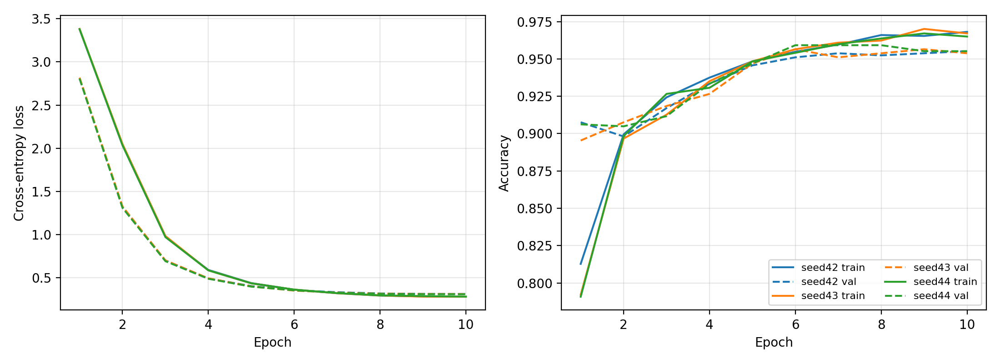

# Vision Transformer (ViT-B/16) Fine-tuning on Oxford-IIIT Pet

> Understanding self-attention for images and transferring an ImageNet-pretrained **ViT-B/16** to fine-grained classification of **37 cat and dog breeds**.


<p align="center">
  
</p>

## Table of Contents
- [Overview](#overview)
- [Results](#results)
- [Dataset](#dataset)
- [Method](#method)
- [Repository Structure](#repository-structure)
- [Getting Started](#getting-started)
- [Reproducing the Experiments](#reproducing-the-experiments)
- [Checkpoints](#checkpoints)
- [Demo](#demo)
- [Team](#team)
- [References](#references)
- [License](#license)

## Overview
Final-term project of the **Deep Learning** course, Faculty of Information Technology, HUFLIT (Ho Chi Minh City University of Foreign Languages – Information Technology), academic year 2026–2027. Instructor: Tôn Quang Toại.

The project answers three questions with the same data split and training protocol:
1. **Q1** – With the same ImageNet-1K pre-training, does ViT-B/16 outperform the convolutional baseline ResNet-50 [4]?
2. **Q2** – How much of ViT-B/16 must be updated: only the head, the last four encoder blocks, or the whole network?
3. **Q3** – How sensitive is the main configuration to the learning rate and to data augmentation?

## Results
All runs: Google Colab, NVIDIA T4 16 GB, batch 64, at most 10 epochs, checkpoint with the lowest validation loss. Validation set: 736 images (20 % of the official `trainval`, stratified, seed 42).

| ID | Model | Strategy | Trainable params | Val accuracy (%) | Val loss | Time / epoch (s) | Peak GPU memory (MiB) |
|----|-------|----------|-----------------:|-----------------:|---------:|-----------------:|----------------------:|
| E1 | ResNet-50 | full fine-tuning | 23,583,845 | 93.75 | 0.4352 | 39.5 | 3,036.9 |
| E2 | ViT-B/16 | feature extraction (linear probe) | 28,453 | 93.07 | 0.3570 | 51.2 | 861.4 |
| E3 | ViT-B/16 | fine-tune last 4 blocks | 28,381,477 | 94.97 | 0.2371 | 44.4 | 2,140.6 |
| E4 | ViT-B/16 | full fine-tuning, seeds 42/43/44 | 85,827,109 | **95.47 ± 0.08** | 0.3097 ± 0.0019 | 55.2 | 5,291.8 |

E5 changes one factor of the E4 recipe at a time (seed 42):

| Run | Learning rate | Augmentation | Val accuracy (%) | Val loss |
|-----|--------------:|:------------:|-----------------:|---------:|
| E5-LR1 | 0.001 | on | 91.30 | 1.1390 |
| E5-LR2 (= E4 seed 42) | 0.003 | on | 95.52 | 0.3112 |
| E5-LR3 | 0.01 | on | 95.65 | 0.1587 |
| E5-LR4 | 0.03 | on | 95.11 | 0.1487 |
| E5-AUG | 0.003 | off | 95.92 | 0.2655 |

With 736 validation images one image is 0.14 percentage points and the standard error at 95 % accuracy is about 0.8 points, so differences below about 2 points between single-seed runs are not conclusive.

Test set (official `test` split, 3,669 images, evaluated once per model):

| Model | Top-1 (%) | Top-5 (%) | Macro precision (%) | Macro recall (%) | Macro F1 (%) | Errors |
|-------|----------:|----------:|--------------------:|-----------------:|-------------:|-------:|
| ResNet-50 (E1) | 90.38 | 99.54 | 90.48 | 90.31 | 90.21 | 353 |
| ViT-B/16 (E4, seed 44) | **93.32** | **99.84** | **93.40** | **93.27** | **93.25** | 245 |

243 of the 245 ViT-B/16 errors confuse two breeds of the same species; the most frequent are Ragdoll → Birman (20) and Staffordshire Bull Terrier → American Pit Bull Terrier (18). Inference on a T4 with mixed precision: ResNet-50 7.79 ms per image (batch 1) and 885.7 images/s (batch 64); ViT-B/16 9.77 ms and 349.6 images/s. Each value comes from `results/<experiment>/` and `results/speed_size.json`.

For context, Dosovitskiy *et al.* report 93.81 % on Oxford-IIIT Pets for ViT-B/16 pretrained on ImageNet and fine-tuned at 384 × 384 with batch 512 ([1], Table 5). Our setting differs (224 × 224, batch 64, `torchvision` weights), so the numbers are not directly comparable.

An independent ViT-B/16 written with PyTorch primitives (`src/models/ky_independent_vit.py`) loads the E4 seed-44 weights and reproduces the `torchvision` logits on four inputs (maximum absolute difference 2.6 × 10⁻⁶, same top-1), see `docs/KY_VIT_LOGITS_VERIFICATION.json`.

## Dataset
**Oxford-IIIT Pet** [3]: 37 breeds (12 cat, 25 dog), 7,349 annotated images. 32 of the 37 classes have exactly 100 `trainval` images; the smallest class (Egyptian Mau) has 93.

| Split | Images | Usage |
|-------|-------:|-------|
| official `trainval` → train | 2,944 | training |
| official `trainval` → val | 736 | checkpoint selection, early stopping, hyper-parameters |
| official `test` | 3,669 | final evaluation, once per model |

The split is stored in `data/splits/train.csv` and `data/splits/val.csv` with SHA-256 hashes of the annotation files in `data/splits/metadata.json`; every experiment reads the same files. Images are **not** stored in this repository; they are downloaded by `torchvision.datasets.OxfordIIITPet(download=True)`. Licence: CC BY-SA 4.0 (see [`docs/data_card.md`](docs/data_card.md)).

## Method
- Backbone: `torchvision.models.vit_b_16`, `ViT_B_16_Weights.IMAGENET1K_V1` (86.6 M parameters, ImageNet-1K top-1 81.07 %); baseline `resnet50`, `ResNet50_Weights.IMAGENET1K_V2` (ImageNet-1K top-1 80.86 %).
- Head: zero-initialised `Linear(768 → 37)` replacing the ImageNet head ([1], Sec. 3.2).
- Transfer strategies: feature extraction, partial fine-tuning (last 4 blocks + final LayerNorm), full fine-tuning (`src/models/factory.py`).
- Optimisation: SGD, momentum 0.9, no weight decay, learning rate 0.003 with a 1-epoch linear warm-up and per-step cosine decay, global gradient-norm clipping at 1, mixed precision ([1], App. B.1.1).
- Pre-processing: evaluation = resize 256 → center crop 224 → ImageNet mean/std; training = `RandomResizedCrop(224, scale=(0.7, 1.0))`, horizontal flip, mild `ColorJitter`.
- Attention rollout [5] for qualitative inspection (`notebooks/04_attention_maps.ipynb`, demo option `--attention`).
- Full protocol and sources: [`docs/experiment_protocol.md`](docs/experiment_protocol.md).

## Repository Structure
```
vit-oxford-pets/
├── app/              # Gradio demo (top-5 breeds, optional attention rollout)
├── configs/          # YAML config of every experiment (inherits base.yaml)
├── data/splits/      # train/val index files and metadata (images are NOT committed)
├── docs/             # data card, experiment protocol, references, verification records
├── figures/          # figures used in the README and the report
├── notebooks/        # environment check, training runs, attention maps on Colab
├── results/          # log.csv, metrics.json, summary.json and test evaluation of each experiment
├── src/              # data, training, models (factory and independent ViT)
└── tests/            # unit tests run by GitHub Actions (ruff + pytest)
```

## Getting Started
```bash
git clone https://github.com/duyenphung206-sudo/vit-oxford-pets.git
cd vit-oxford-pets
pip install -r requirements.txt
python -m pytest
```
Versions in `requirements.txt` are the ones verified on Google Colab (Python 3.13, PyTorch 2.14.1, torchvision 0.29.1) by `notebooks/00_setup_check.ipynb`.

## Reproducing the Experiments
Every experiment is one YAML file in `configs/` and is trained with the same command. From a terminal (dataset under `<data_root>/oxford-iiit-pet`, `data.root` in `configs/base.yaml` set to `<data_root>`):
```bash
python -m src.train --config configs/e1_resnet50.yaml --seed 42          # E1
python -m src.train --config configs/e2_vit_linear_probe.yaml --seed 42  # E2
python -m src.train --config configs/e3_vit_partial.yaml --seed 42      # E3
python -m src.train --config configs/e4_vit_full_ft.yaml --seed 42      # E4, repeat with --seed 43 and 44
python -m src.train --config configs/e5_lr1.yaml --seed 42              # E5, also e5_lr3, e5_lr4, e5_aug
python -m src.train --config configs/e4_vit_full_ft.yaml --fake-data --epochs 1   # pipeline check without the dataset
```
Outputs go to `results/<experiment>/seed<seed>/`, checkpoints to `checkpoints/<experiment>/seed<seed>/best.pt` (ignored by git). The Colab notebooks in `notebooks/` run the same commands on a T4 GPU.

## Checkpoints
Checkpoints are not stored in the repository (about 343 MB for ViT-B/16). The E4 checkpoint used for evaluation and the demo (seed 44, lowest validation loss) is attached to the GitHub Release [`v1.0.0`](https://github.com/duyenphung206-sudo/vit-oxford-pets/releases/tag/v1.0.0) as `vit_b16_e4_seed44_best.pt`.

## Demo
```bash
python app/app.py --checkpoint <path/to/vit_b16_e4_seed44_best.pt> --device cpu --port 7860 --attention
```
Then open http://127.0.0.1:7860, upload a cat or dog photo and read the five most likely breeds with the attention rollout map. Use `--device cuda` on a GPU; drop `--attention` to show only the top-5 list.

## Team
| Member | Student ID | Main responsibilities | GitHub |
|--------|-----------|-----------------------|--------|
| Phùng Thị Hoàng Duyên (leader) | 24DH190211 | model factory, training pipeline, experiment protocol, E4, repository and releases | [@duyenphung206-sudo](https://github.com/duyenphung206-sudo) |
| Nguyễn Ngọc Kỳ | 24DH112710 | data pipeline and EDA, E2, E3, E5, independent ViT, demo | [@Edward2106](https://github.com/Edward2106) |
| Nguyễn Lê Yến Trinh | 24DH190271 | ViT and self-attention analysis, architecture diagrams, references | [@nlyen-trinh](https://github.com/nlyen-trinh) |
| Đức Tâm | 24DH190351 | E1, test evaluation, speed and size, error analysis, attention visualisation | [@Bambizled](https://github.com/Bambizled) |

## References
[1] A. Dosovitskiy *et al.*, "An image is worth 16x16 words: Transformers for image recognition at scale," in *Proc. Int. Conf. Learn. Represent. (ICLR)*, 2021.
[2] A. Vaswani *et al.*, "Attention is all you need," in *Adv. Neural Inf. Process. Syst.*, vol. 30, 2017, pp. 5998–6008.
[3] O. M. Parkhi, A. Vedaldi, A. Zisserman, and C. V. Jawahar, "Cats and dogs," in *Proc. IEEE Conf. Comput. Vis. Pattern Recognit. (CVPR)*, 2012, pp. 3498–3505, doi: 10.1109/CVPR.2012.6248092.
[4] K. He, X. Zhang, S. Ren, and J. Sun, "Deep residual learning for image recognition," in *Proc. IEEE Conf. Comput. Vis. Pattern Recognit. (CVPR)*, 2016, pp. 770–778.
[5] S. Abnar and W. Zuidema, "Quantifying attention flow in transformers," in *Proc. 58th Annu. Meeting Assoc. Comput. Linguistics (ACL)*, 2020, pp. 4190–4197, doi: 10.18653/v1/2020.acl-main.385.

## License
Code: [MIT](LICENSE). Dataset: CC BY-SA 4.0, © original image owners — see [3].
